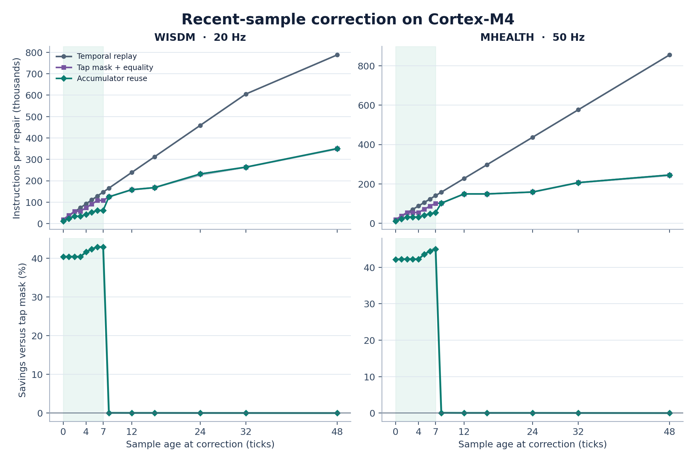

# Bit-exact late-sample correction for TinyML

A causal INT8 classifier can revise already-issued predictions when a timestamped accelerometer sample arrives late. The revised method caches recent INT32 convolution accumulators and recalculates only the affected products, with a bounded full-recomputation path when needed. The study measures short and long delays, burst delivery, append overhead, and memory on emulated Cortex-M CPUs.



## Revised study

| Dataset | Held-out people | Clips | Recent instructions saved | Savings across scenarios | Method SRAM |
| --- | ---: | ---: | ---: | ---: | ---: |
| WISDM | 51 | 162 | 40.9% | 5.2% | 7,372 B |
| MHEALTH | 10 | 108 | 42.4% | 13.1% | 7,528 B |

The reference is tap-mask correction with exact activation equality. Recent cases use one delayed sample with an age of 0 to 7 steps. Across all scenarios, the accumulator method saves 43.0% on WISDM and 50.9% on MHEALTH versus temporal replay.

The revised corpus includes 18 trained models, 168,236 ARM benchmark runs (1,220 in Renode), and 2,025 separate native streaming replays. There were zero score mismatches. Cache maintenance added 0.52% and 0.58% to append instructions in the controlled build. Clean held-out accuracy averaged 46.0% and 56.7%, respectively.

The cache delivers its largest incremental savings for corrections within the eight-sample window. Older isolated corrections use the dependency mask and see little extra benefit from the accumulator cache. Batching is evaluated separately. Table 9 provides compact LaTeX for a letter column.

The main comparison times identical compiled firmware variants on Unicorn's Cortex-M4 CPU. A matched Renode experiment uses the same firmware, model weights, oracle, and held-out participants. The results report instruction counts and observed SRAM. Both datasets use recorded acceleration with controlled delays.

| Item | Location |
| --- | --- |
| Exact algorithm and arithmetic | [Accumulator method](docs/accumulator_method.md) |
| Experimental protocol and metrics | [Fold study](docs/fold_study.md) |
| Model training and splits | [Training and held-out data](notebooks/05_cross_subject_models.ipynb) |
| ARM emulation and agreement | [Cross-emulator notebook](notebooks/06_arm_confirmation.ipynb) |
| Plots and ablation tables | [Results notebook](notebooks/07_accumulator_results.ipynb) |
| Per-case measurements and models | [Results archive](results/v2/) |
| Participant-covering replay clips | [Data attribution](replay_clips/ATTRIBUTION.md) |
| Publication graphics | [Vector PDF, SVG, and PNG](figures/v2/) |

## Reproduce the revised study

The tested environment is Linux x86-64, Python 3.12, Arm GNU Toolchain 14.2.1, Renode 1.17.0, and Unicorn 2.1.4. Put `arm-none-eabi-gcc`, `arm-none-eabi-nm`, and `renode` on `PATH` or set `ARM_GCC`, `ARM_NM`, and `RENODE` to executable paths. The trained weights and CC BY 4.0 excerpts support offline execution after the tools have been installed.

```bash
python3.12 -m venv .venv
source .venv/bin/activate
python -m pip install -r requirements.txt
python -m unittest discover -s tests -v
python -m tinyml.counter_check
python -m tinyml.study_v2 --workers 3
python -m tinyml.native_v2 --workers 3
python -m tinyml.analysis_v2
```

For one model, run `python -m tinyml.study_v2 --cohorts main --dataset wisdm --fold 0 --seed 13`. With the delivered archive, `python -m tinyml.analysis_v2` regenerates the figures and tables without re-executing the CPU benchmarks. The full study can resume completed batches with `--reuse`. Run without that flag after changing kernels or models.

To regenerate the training and replay inputs from their original UCI archives:

```bash
python -m pip install -r requirements-train.txt
python -m tinyml.data
python -m tinyml.folds
python -m tinyml.train_folds --workers 3
```

The three revised notebooks include saved outputs. `TINYML_NOTEBOOK_REBUILD=1` requests model training in notebook 05 and a fresh two-emulator confirmation slice in notebook 06. Notebook 07 regenerates the figures from all archived trial records. Notebook execution can be limited with `python scripts/execute_notebooks.py --match 06`.

## Original single-split study

The original tests, event data, committed figures, and notebooks 01–04 are included for comparison. Use `python -m tinyml.evaluate --backend native`, `python -m tinyml.evaluate --backend renode`, and `python -m tinyml.analysis` for that study. Its setup and results are recorded in [the original README](docs/original_readme.md). The two studies train different models and use different test partitions.
