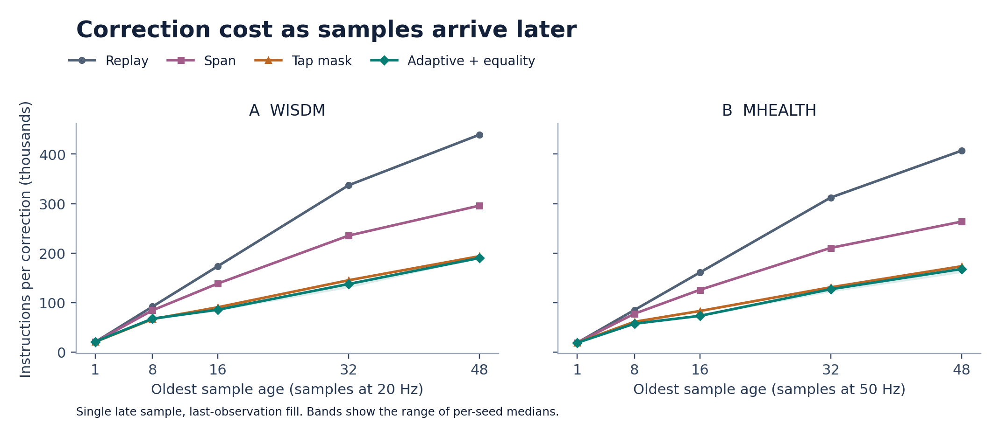

# Bit-exact late-sample correction for TinyML

This repository evaluates how a small INT8 temporal CNN can revise already-issued predictions when a timestamped accelerometer sample arrives late. The Cortex-M4 firmware reuses cached state and visits the convolution timestamps that can be affected by a correction. All experiments can be reproduced without a board.



## Results

| Dataset | Replay cases per seed | Instructions saved | Cases with savings | Observed method SRAM |
| --- | ---: | ---: | ---: | ---: |
| WISDM | 306 | 27.9% ± 1.2 pp | 83.3% | 3,714 B |
| MHEALTH | 204 | 35.6% ± 0.8 pp | 89.5% | 3,420 B |

The table compares the adaptive correction method with temporal replay at a maximum age of 48 samples. Savings show the mean ± sample standard deviation of three seed medians. Across all budgets and modes, 14,160 Cortex-M4 runs checked 19,691,712 score pairs with zero mismatches. The native C evaluation checked 207,657,216 score pairs across 158,400 method runs with zero mismatches.

Batching contiguous bursts of eight saved roughly three quarters of the instructions used for serial repair. Exact INT8 equality reduced computation on some traces and slightly increased median instructions in paired comparisons that isolate its overhead. Table 3 reports those effects and the cases where each change saved instructions. The measurements cover emulated instruction counts and observed SRAM use. Table 1 gives clean, held-out accuracy for the INT8 models.

## Repository contents

| Path | Contents |
| --- | --- |
| [`firmware/`](../firmware/) | C implementation, public API, Cortex-M4 benchmark, linker script, and the counter self-test |
| [`tinyml/`](../tinyml/) | Dataset preparation, deterministic training, quantization, dense oracle, native and Renode runners, and analysis |
| [`notebooks/`](../notebooks/) | Four executed notebooks covering training, native validation, Cortex-M4, and paper figures |
| [`results/models/`](../results/models/) | FP32 and INT8 weights, held-out metrics and training logs, and complete compressed event data |
| [`results/tables/`](../results/tables/) | Six tables in Markdown, CSV, and LaTeX with `booktabs` |
| [`figures/`](../figures/) | Four figures in PNG, vector PDF, and editable SVG |
| [`replay_clips/`](../replay_clips/) | Held-out, attributed three-axis sensor excerpts for offline reproduction |
| [`docs/method.md`](./method.md) | Algorithm, correctness argument, and the eight compared implementations |
| [`docs/experiment.md`](./experiment.md) | Experimental details, metric definitions, and interpretation |

## Reproduce the measurements

The code was exercised on Linux x86-64 with Python 3.12, native GCC, Arm GNU Toolchain 14.2, and Renode 1.17.0. Use [the Renode 1.17.0 Linux portable release](https://github.com/renode/renode/releases/tag/v1.17.0) and [the Arm GNU Toolchain](https://developer.arm.com/downloads/-/arm-gnu-toolchain-downloads). Put `renode`, `arm-none-eabi-gcc`, and `arm-none-eabi-nm` on `PATH`, or set `RENODE`, `ARM_GCC`, and `ARM_NM` to executable paths. The figures and saved notebooks can be opened immediately. The bundled models and clips allow native and Renode runs without dataset downloads.

```bash
python3.12 -m venv .venv
source .venv/bin/activate
python -m pip install -r requirements.txt
python -m unittest discover -s tests -v
python -m tinyml.counter_check
python -m tinyml.evaluate --backend native --workers 2
python -m tinyml.evaluate --backend renode --workers 2
python -m tinyml.analysis
```

Rebuild the models and fixtures from the two original UCI archives when reproducing the training step. The download verifies the archived files using SHA-256.

```bash
python -m pip install -r requirements-train.txt
python -m tinyml.data
python -m tinyml.protocol
python -m tinyml.train --workers 2 --threads 1
```

Use `--dataset wisdm --seed 13` on either evaluator for a quick single-model run. With fresh model exports, rerun both evaluators before regenerating the tables.

For a single-column manuscript table, see [Table 6](../results/tables/table_06_letter.tex).
The checked-in GitHub workflow runs the native tests and regenerates the tables and figures from the delivered measurements.

## Executed notebooks

| Notebook | Saved execution |
| --- | --- |
| [01 · Training and INT8 export](../notebooks/01_training_and_int8_export.ipynb) | Retrained six classifiers and checked the resulting INT8 parameters against the archived exports |
| [02 · Native exactness](../notebooks/02_native_exactness.ipynb) | Ran edge-case tests and reproduced the full native replay matrix |
| [03 · Cortex-M4 in Renode](../notebooks/03_cortex_m4_renode.ipynb) | Checked the counter, executed the Arm firmware, and compared regenerated event tables |
| [04 · Results and figures](../notebooks/04_results_and_figures.ipynb) | Regenerated six paper tables and four figures from trial-level measurements |

By default, re-opening and executing the delivered notebooks reads the archived results and performs the lightweight checks. Set `TINYML_NOTEBOOK_REBUILD=1` before launching a kernel to rerun the full experimental steps. Set `TINYML_DATA_DIR` to reuse downloaded UCI archives, and `TINYML_NOTEBOOK_WORKERS` to set reproduction concurrency. Notebook rebuilds write to `build/notebooks/` and preserve the delivered results.

Use `python scripts/execute_notebooks.py` to execute the notebooks in place. To render to a different directory, pass `--output-dir PATH`. Install the requirements above and use your active environment's Python kernel.

Data attribution is in [`replay_clips/ATTRIBUTION.md`](../replay_clips/ATTRIBUTION.md). Related work is listed in [`docs/references.md`](./references.md).
